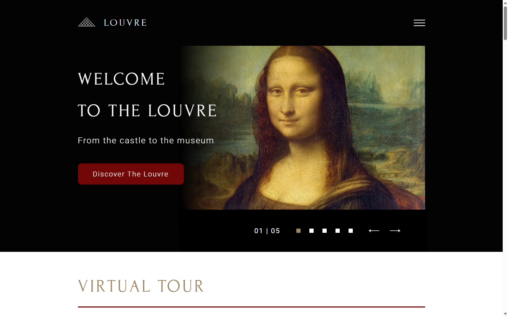

# Louvre — museum website

**[Live demo →](https://reatixx.github.io/museum-louvre/)**



Landing page of the Louvre museum. RS School project.

## Features
- Welcome slider with slide counter and arrows
- Video section: custom player panel and video slider
- Picture gallery with scroll-triggered appearance animation
- Interactive map (Mapbox GL)
- Ticket calculator and booking form with validation
- Responsive layout, SVG sprite

## Stack
HTML5 · SCSS · JavaScript · Vite · Swiper · Mapbox GL · PostCSS

## Run locally
```bash
npm install
npm run dev
```
